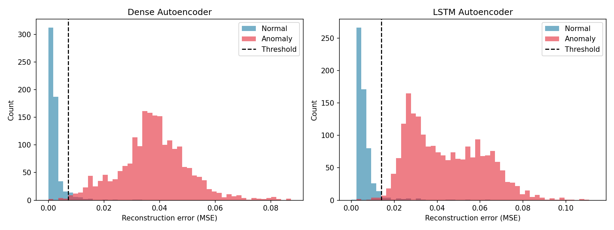
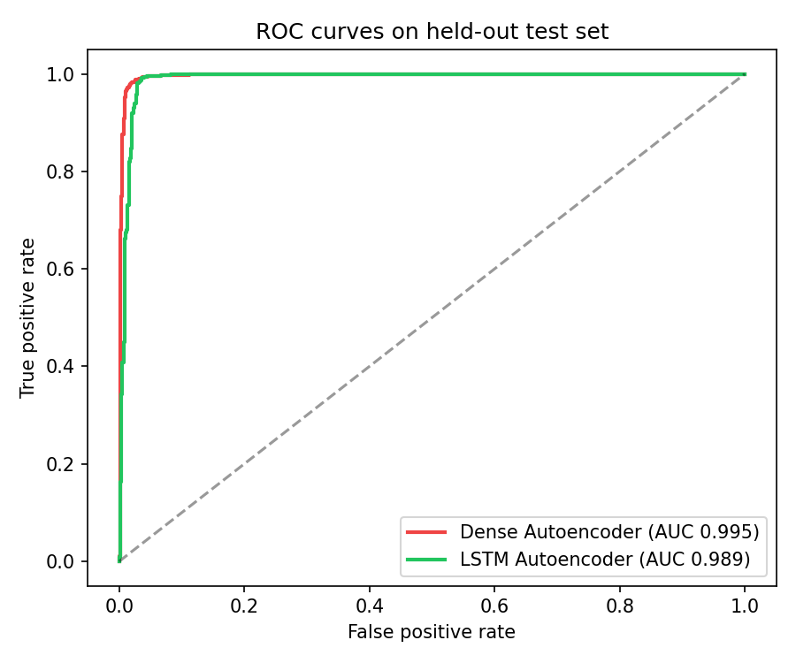

# DeepAnomaly

**Self-supervised anomaly detection for time series: PyTorch autoencoders, FastAPI inference service, React dashboard.**

[Live demo](https://appealing-success-production-8f9e.up.railway.app) · [API docs](https://deepanomaly-timeseries-production.up.railway.app)

## Problem

Anomalies in sensor and biomedical signals (equipment faults, arrhythmias) are rare, diverse, and expensive to label. Supervised detectors need labelled anomalies that usually do not exist.

## Approach

Autoencoders are trained **only on normal sequences**. They learn to reconstruct normal patterns with low error; anomalous input falls outside what they learned, so reconstruction error rises. That error is the detection score, and the threshold is set at the 95th percentile of error on a held-out **normal-only validation set**, so no anomaly labels or test data are used to fit it.

Two architectures are compared:
- **Dense autoencoder:** treats the 140 timesteps as a flat feature vector.
- **LSTM autoencoder:** encodes the sequence through recurrence.

## Results

Held-out test set (ECG5000; the test set contains every anomaly plus unseen normal beats):

[PASTE TABLE FROM docs/results/results.md]

Accuracy is deliberately not reported: the test set is ~78% anomalous, so a trivial "everything is an anomaly" classifier would score ~78%. Precision, recall, F1, ROC-AUC and PR-AUC are reported instead.

## Engineering notes

- **No leakage:** train/val contain normal samples only; the scaler is fit on train only; the threshold comes from validation errors.
- **Out-of-range test values are preserved:** test data is not clipped to [0, 1], since excursions beyond the training range are part of the anomaly signal.
- **Train/serve separation:** `ml/` (offline training) and `backend/` (lean inference image, CPU-only torch).
- **Validated input:** Pydantic enforces sequence length; CSV uploads are checked for shape.
- **Tested:** pytest suite for the API contract and preprocessing invariants.
- **Deployed:** containerised services on Railway.

## Architecture

    ECG5000 -> preprocess -> train (dense / LSTM) -> artifacts
                                                        |
    React dashboard  <--HTTP-->  FastAPI  <-- loads --  artifacts

## Pages

- **Home:** project overview, how it works, and the live detector (upload, model selector, compare mode, reconstruction chart).
- **About:** the problem, approach, pipeline, model details, measured results, tech stack, and limitations.

## Run locally

    # ML pipeline
    python -m venv venv && venv\Scripts\activate
    pip install -r requirements.txt
    python -m ml.data.download_data
    python -m ml.data.preprocess
    python -m ml.training.train --model dense
    python -m ml.training.train --model lstm
    python -m ml.evaluation.report

    # Backend (copy trained artifacts into backend/artifacts first)
    cd backend && pip install -r requirements.txt
    uvicorn app.main:app --reload --port 8000

    # Frontend
    cd frontend && npm install && npm run dev

Try it with `docs/sample_data/demo_sequences.csv` (ground truth in `demo_labels.csv`).

## Limitations

- Evaluated on a single dataset (ECG5000), which is relatively easy; results may not transfer to noisier industrial sensors.
- The 95th-percentile threshold fixes the false-positive rate on normal data at about 5% by design. Real deployments should tune it to the cost of a false alarm.
- Detects *that* a sequence is abnormal, not *which type* of abnormality.
- Univariate input; the multivariate extension (e.g. NASA Turbofan) is future work.

## Dataset and references

- [ECG5000](https://www.timeseriesclassification.com/description.php?Dataset=ECG5000), UCR Time Series Archive
- [A Review on Self-Supervised Learning for Time Series Anomaly Detection](https://arxiv.org/abs/2501.15196)
- [Self-Supervised Learning for Time-Series Anomaly Detection in Industrial IoT](https://www.mdpi.com/2079-9292/11/14/2146)

**Author:** Ankur Saini (23EBKAI009), B.Tech AI, 7th semester